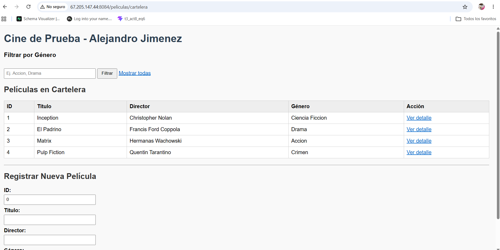
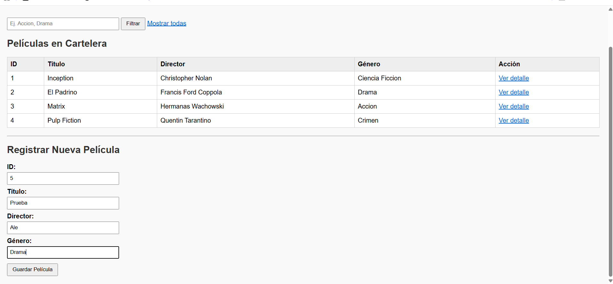
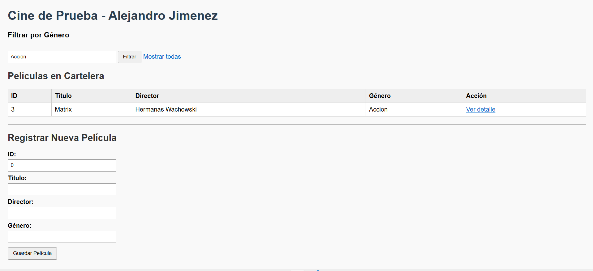
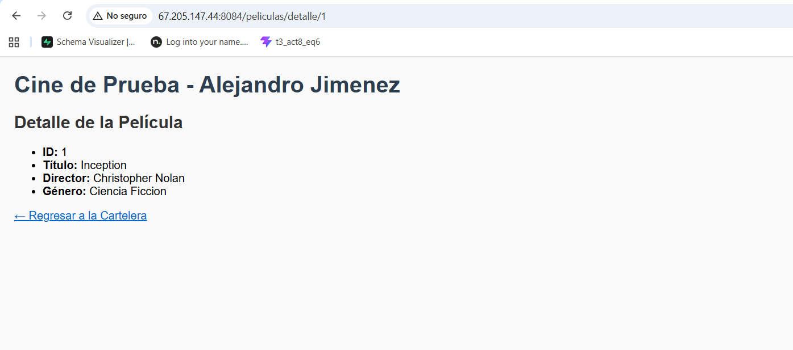
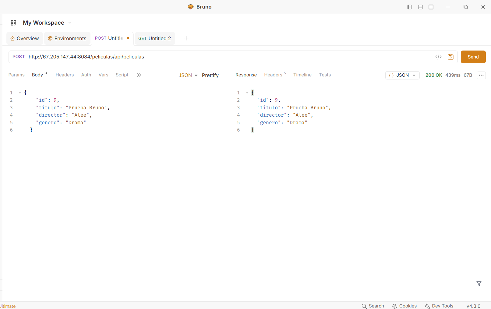

# Actividad 2: Catálogo de Películas - Spring Boot y Thymeleaf

**Desarrollador:** Alejandro Jimenez  
**Puerto del servidor:** `8084`  

---

## Descripción del Proyecto

Este proyecto implementa un módulo sencillo de **Catálogo de Películas** desarrollado con **Spring Boot** y **Thymeleaf**

- Carga de propiedades mediante `@Value` desde `application.properties`.
- Uso de colecciones de datos en memoria (`List<PeliculaDTO>`).
- Paso de datos del controlador a la vista utilizando `Model`.
- Filtrado y lectura de parámetros de consulta con `@RequestParam`.
- Parámetros de ruta dinámica con `@PathVariable`.
- Formularios con `@ModelAttribute`.
- Creación de endpoint de servicio REST con `@RequestBody` y `@ResponseBody` probado con Postman / Bruno. 

---

## Endpoints Disponibles

| Método | Ruta | Descripción |
| :--- | :--- | :--- |
| **GET** | `/peliculas/cartelera` | Listado general de películas |
| **GET** | `/peliculas/cartelera?genero={genero}` | Filtro de películas por género |
| **GET** | `/peliculas/detalle/{id}` | Vista detallada de una película por su ID | 
| **POST** | `/peliculas/guardar` | Guarda una nueva película desde el formulario web |
| **POST** | `/peliculas/api/peliculas` | Endpoint REST para registrar una película vía JSON |  

---

## Capturas de pantalla
---

### 1. Vista con el Listado (`th:each` funcionando)
- **Ruta probada:** `http://67.205.147.44:8084/peliculas/cartelera`
- **Descripción:** Muestra la cartelera general con la tabla generada dinámicamente mediante el atributo `th:each="peli : ${peliculas}"` y el título inyectado con `@Value`.



---

### 2. Formulario con `@ModelAttribute`
- **Ruta probada:** `http://67.205.147.44:8084/peliculas/cartelera` y `http://67.205.147.44:8084/peliculas/guardar`
- **Descripción:** Formulario en la parte inferior de la cartelera vinculado con `th:object="${nuevaPelicula}"`, enviando los datos mediante `POST` hacia el método `@PostMapping("/guardar")` anotado con `@ModelAttribute` y reflejando la película recién agregada en la tabla.



---

### 3. Resultado del Endpoint con `@RequestParam`
- **Ruta probada:** `http://67.205.147.44:8084/peliculas/cartelera?genero=Accion`
- **Descripción:** Demuestra la filtración de la cartelera a través del parámetro de consulta `genero` capturado por `@RequestParam(required = false) String genero` en el controlador.



---

### 4. Resultado del Endpoint con `@PathVariable`
- **Ruta probada:** `http://67.205.147.44:8084/peliculas/detalle/1`
- **Descripción:** Muestra la vista `detalle_pelicula.html` cargada mediante la variable de ruta `{id}` capturada por `@PathVariable int id` en el controlador.



---

### 5. Petición POST probada en Postman / Bruno
- **Método:** `POST`
- **URL:** `http://67.205.147.44:8084/peliculas/api/peliculas`
- **Contenido:**
  ```json
  {
    "id": 5,
    "titulo": "Oppenheimer",
    "director": "Christopher Nolan",
    "genero": "Drama"
  }
  ```
- **Descripción:** Muestra el envío del JSON y la respuesta `200 OK` retornando el objeto serializado gracias a `@RequestBody` y `@ResponseBody`.



---

## Cómo Ejecutar el Proyecto


1. Abrir el navegador en:
   ```text
   http://67.205.147.44:8084/peliculas/cartelera
   ```

